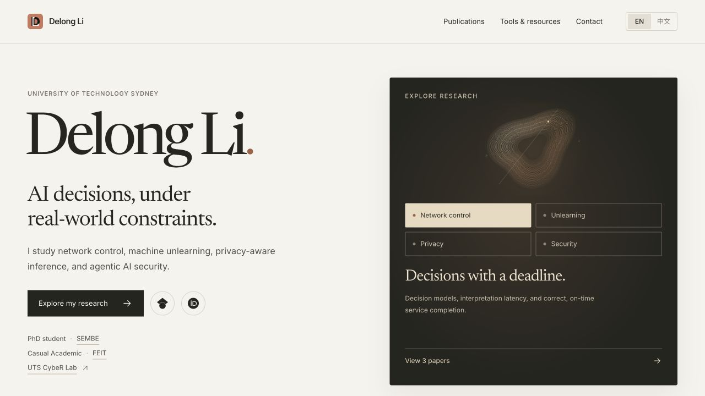

<h1>Delong Li</h1>

Academic website · AI decisions under real-world constraints

<a href="https://delong-l.github.io/"><strong>Visit the website</strong></a> · <a href="https://delong-l.github.io/zh/">中文网站</a> · <a href="README.zh-CN.md">中文说明</a>

Research on network control, machine unlearning, privacy-aware inference, and agentic AI security. The website brings together selected research, publications, research tools, and contact links in English and Chinese.

## Explore

| Find | Open |
|---|---|
| Research directions and selected work | [Research](https://delong-l.github.io/#publications) |
| Papers and publication records | [Publications](https://delong-l.github.io/publications/) |
| Research skills and workflow resources | [Tools and resources](https://delong-l.github.io/tools/) |
| Contact and professional profiles | [Contact](https://delong-l.github.io/#contact) |

## Repository

The site uses static HTML, CSS, and JavaScript. `index.html` is the English homepage, `zh/` contains Chinese pages, `publications/` contains publication browsing, and `assets/` contains styles and media. GitHub Pages serves the website from this repository.

For a content correction or broken link, [open an issue](https://github.com/DELONG-L/delong-l.github.io/issues) and include the page address.
