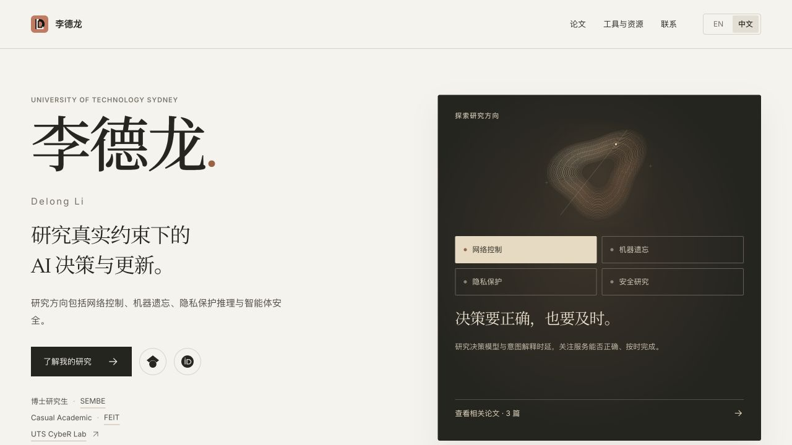

<h1>Delong Li</h1>

学术个人主页 · 现实约束下的人工智能决策

<a href="https://delong-l.github.io/zh/"><strong>访问中文网站</strong></a> · <a href="https://delong-l.github.io/">English website</a> · <a href="README.md">English README</a>

研究涉及网络控制、机器遗忘、隐私感知推理和智能体人工智能安全。网站以中英文介绍研究方向、代表性工作、论文、科研工具和联系方式。

## 浏览内容

| 内容 | 入口 |
|---|---|
| 研究方向与代表性工作 | [研究](https://delong-l.github.io/zh/#publications) |
| 论文与发表记录 | [论文列表](https://delong-l.github.io/zh/publications/) |
| 科研技能与工作流资源 | [工具与资源](https://delong-l.github.io/zh/tools/) |
| 联系方式与学术档案 | [联系](https://delong-l.github.io/zh/#contact) |

## 仓库结构

网站使用静态 HTML、CSS 和 JavaScript。`index.html` 是英文首页，`zh/` 保存中文页面，`publications/` 提供论文浏览，`assets/` 保存样式和媒体资源。网站通过本仓库的 GitHub Pages 发布。

发现内容或链接问题时，可以[提交 Issue](https://github.com/DELONG-L/delong-l.github.io/issues)，并附上对应页面地址。
